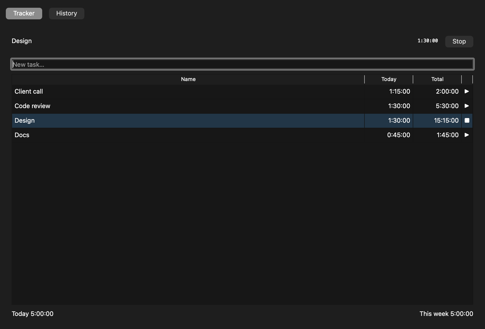
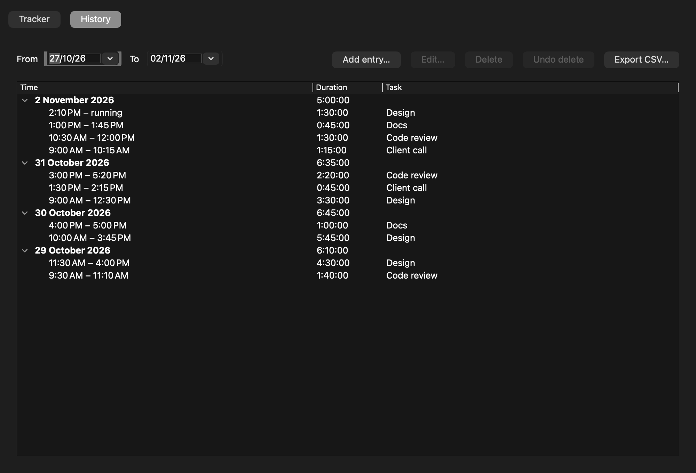

# Time Tracker

A small, local-first time tracker for the desktop. Start a timer for a task, see what you did today and this week, and review and fix past sessions in a day-by-day history. Everything is stored in a single SQLite file on your machine. No account, no network.

Built with Qt 6 and C++17.

## Screenshots

**Tracker**: start a task, see today's and total time per task, and the running timer in the header.



**History**: sessions grouped by day with day totals. Edit, add, delete (with undo), and export to CSV.



## Features

- **One timer at a time.** Starting a task stops the one that is running.
- **Timestamp-based timing.** Elapsed time is always the current time minus the start time, so it stays correct across sleep and wake.
- **Tracker screen.** Per-task Today and Total columns, Today and This week totals, and a new-task field where pressing Return creates and starts the task.
- **History screen.** Day headers with totals, a From/To date filter (last 7 days by default), and Add, Edit, Delete, and Undo for sessions. Overlapping or backwards time ranges are rejected.
- **CSV export** of the sessions in the selected date range.
- **Tray / menu bar.** A tray icon with a menu: status, Stop, five recent tasks, Open Tracker, Open History, Quit. On macOS the running time also appears in the menu bar.
- **Recovery after a crash or long sleep.** If a timer is still running after more than 12 hours on launch, you choose to keep it, stop it at the last time the app was alive, or discard it.
- **Long-running reminder.** A one-time "Still tracking?" message when a timer passes a configurable threshold (default 8 hours).
- **Closing the window keeps the app in the tray** (when a tray is available).

### Keyboard shortcuts

On macOS, `Ctrl` in the table below means `Cmd`.

| Shortcut | Action |
| --- | --- |
| `Space` | Start or stop the selected task (when the task table has focus) |
| `Ctrl+N` | Focus the new-task field |
| `Ctrl+.` | Stop the running timer |
| `Ctrl+Z` | Undo the last delete in History |
| `Ctrl+Q` | Quit |

## Requirements

- CMake 3.21 or newer
- Qt 6.5 or newer, with the Core, Gui, Widgets, Sql, and Test modules
- A C++17 compiler
- macOS (Apple Silicon) is the platform the app is built and tested on

Install Qt with Homebrew on macOS:

```sh
arch -arm64 brew install qt clang-format
```

## Build and run

The project uses CMake presets. The debug preset is shown below; `release` works the same way.

```sh
cmake --preset debug
cmake --build --preset debug
open build/debug/TimeTracker.app          # macOS
```

The presets point `CMAKE_PREFIX_PATH` at `/opt/homebrew/opt/qt`, which is where Homebrew installs Qt on Apple Silicon. If Qt is installed somewhere else, edit `CMakePresets.json` or pass `-DCMAKE_PREFIX_PATH=<your Qt prefix>` to CMake.

## Tests

```sh
QT_QPA_PLATFORM=offscreen ctest --preset debug --output-on-failure
```

The suite covers:

- time utilities, including DST transitions and midnight splits, run under UTC, America/New_York, and Europe/Berlin
- the SQLite repositories, using an in-memory database
- the tracker service, using a fake clock
- the widgets, driven offscreen (create, toggle, shortcuts, history edits, dialogs, tray menu)

Some checks that depend on a visual result, such as the menu bar text and the tray icon, are listed in [`docs/MANUAL_TEST.md`](docs/MANUAL_TEST.md).

## Where your data lives

The database is `timetracker.db` in the application data folder:

- macOS: `~/Library/Application Support/TimeTracker/`

Settings (the reminder threshold) are stored with Qt's `QSettings` in the platform's usual location.

## Project layout

```
src/core/   Time logic, SQLite persistence, TrackerService (QtCore + QtSql only)
src/ui/     Widgets: tracker page, history page, tray, dialogs
src/app/    main()
tests/      Test executables (QTest)
docs/       Requirements, plan, manual test checklist, screenshots
```

The core library has no dependency on the widgets, so the time logic is tested without a display.

## Status

Implemented through the Robustness phase. Still to do:

- Packaging: a signed macOS app bundle and a Linux AppImage with a desktop entry.
- Linux is not yet built or tested.
- Launch at login is not implemented.

See [`docs/PLAN.md`](docs/PLAN.md) for the phase-by-phase checklist and [`docs/SEPC.md`](docs/SEPC.md) for the requirements.

## License

To be decided.
